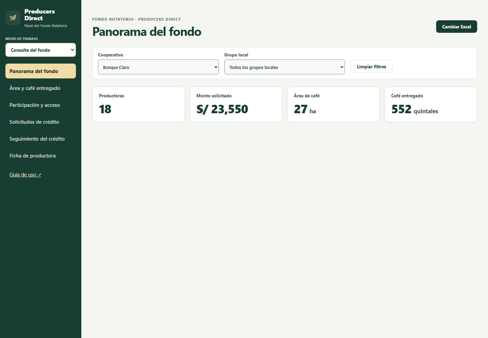
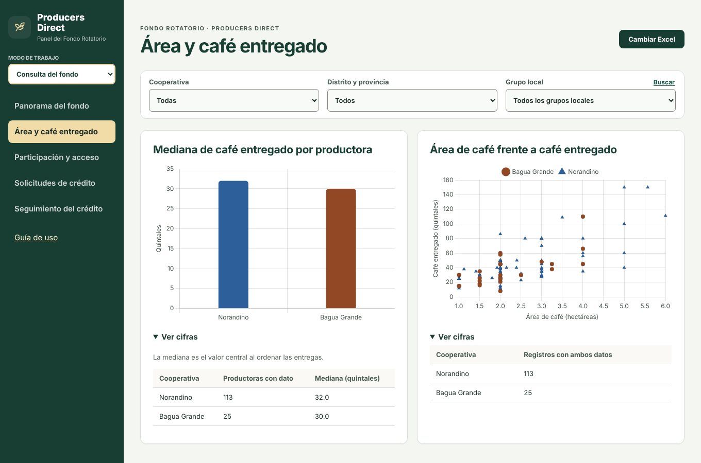
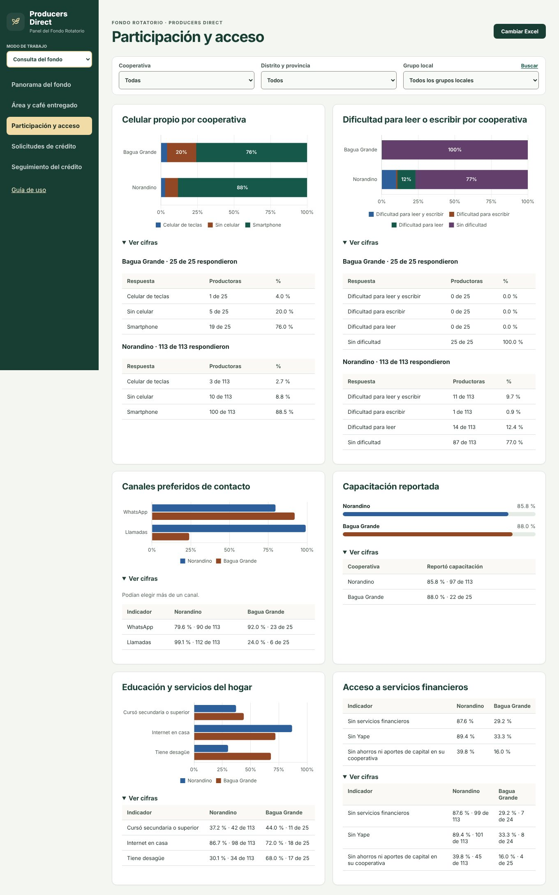
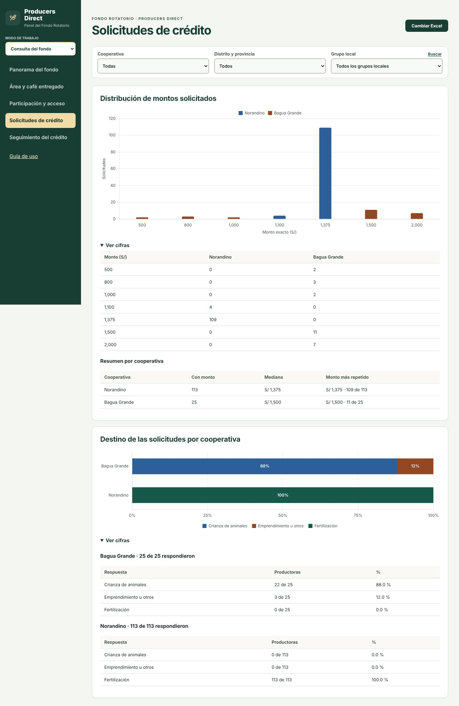
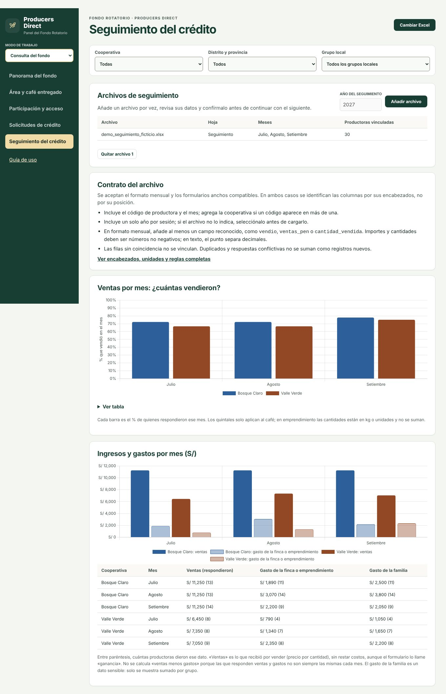
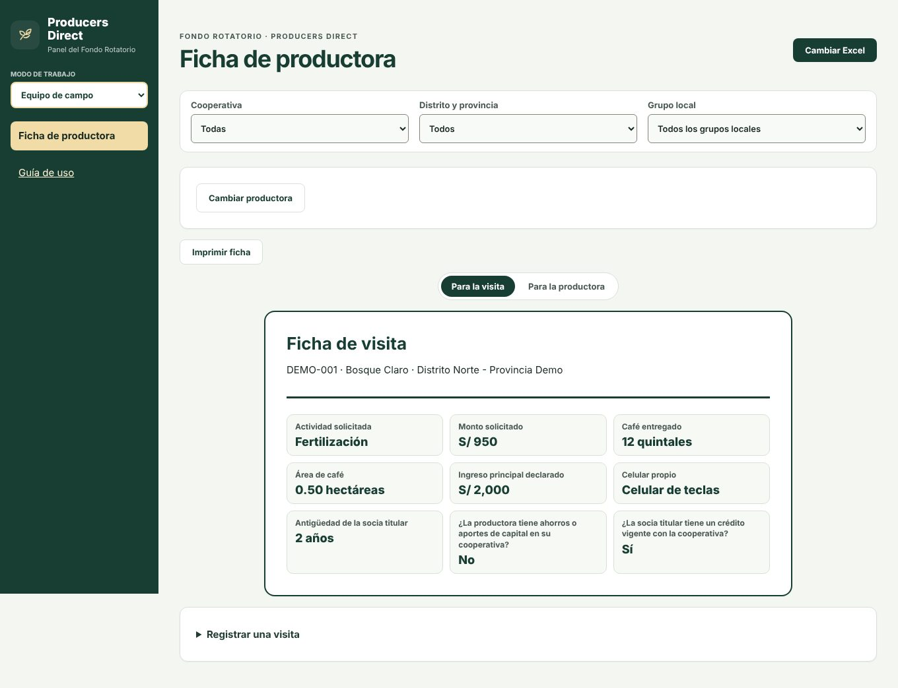
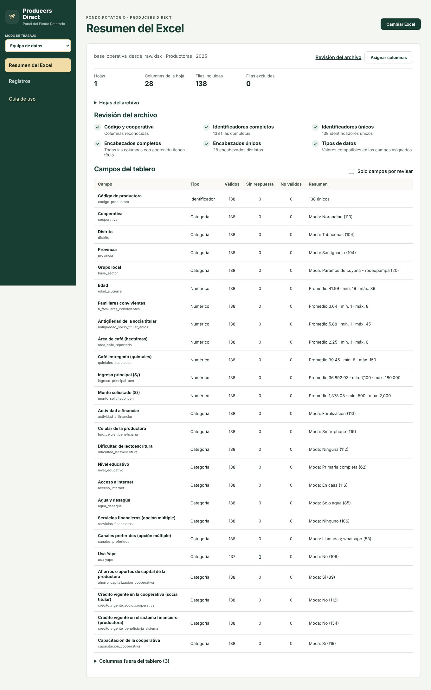

# Informe de visualizaciones

Cada visual del tablero con su propósito, la forma de leerlo y la decisión que apoya, agrupado por pantalla. Los visuales usan los filtros de cooperativa, distrito y grupo local y se recalculan al cargar un Excel o al cambiar un filtro. Los porcentajes usan las respuestas disponibles de cada grupo y las cantidades exactas están en «Ver cifras». Las capturas son de los datos de Norandino y Bagua Grande. Para el detalle técnico de cada medida, consulta el [informe técnico](INFORME_TECNICO.md).

## Panorama del fondo

| Visual | Propósito | Cómo leerlo | Decisión que apoya |
|---|---|---|---|
| **Tarjetas: productoras, monto solicitado, área de café y café entregado** | Dimensionar el fondo: cuántas productoras hay, cuánto se solicitó y cuánta superficie y café se reportó. | Cuatro tarjetas con la suma de la selección actual. «29 de 30 con dato» indica cuántas productoras aportan al total; un dato faltante no cuenta como cero. | Decidir si el volumen justifica una visita o un ajuste del presupuesto; confirmar que un total sea comparable antes de citarlo. |
| **Monto solicitado por distrito** | Comparar dónde se concentra el dinero solicitado. | Una barra horizontal por distrito (nombre en dos líneas: distrito y provincia), en soles. «Ver cifras» abre la tabla con los valores exactos. | Priorizar los distritos con más solicitud al planificar la ruta de campo. |
| **Área de café por distrito** | Comparar la superficie de café reportada por distrito. | Una barra por distrito en hectáreas; «Ver cifras» muestra cuántas productoras aportan al total. | Estimar el tamaño productivo de cada zona antes de definir apoyos técnicos. |
| **Café entregado por distrito** | Comparar el café entregado a la cooperativa por distrito. | Una barra por distrito en quintales; «Ver cifras» da los valores exactos. | Identificar las zonas que más aportan a la cooperativa y las que necesitan acompañamiento. |
| **Productoras por distrito y provincia** | Mostrar cuántas productoras hay en cada distrito y provincia. | Mapa de rectángulos: el área es proporcional al número de productoras y cada uno lleva el nombre completo y la cantidad exacta. Debajo, una tabla con productoras, monto, área y café. | Ver si la muestra depende de un solo distrito antes de generalizar conclusiones. |

## Área y café entregado

| Visual | Propósito | Cómo leerlo | Decisión que apoya |
|---|---|---|---|
| **Mediana de café entregado por productora** | Saber cuánto café entrega una productora típica de cada cooperativa. | Una barra por cooperativa con la mediana: al menos la mitad tiene una entrega menor o igual a la mediana y al menos la mitad, mayor o igual. | Comparar cooperativas sin que valores muy altos distorsionen el promedio y fijar expectativas de entrega. |
| **Área de café frente a café entregado** | Ver si más área de café se acompaña de más café entregado. | Cada punto es una productora con ambos datos; la forma y el color indican la cooperativa. Si los puntos suben hacia la derecha, más área suele ir con más café. | Detectar productoras con mucha área y poca entrega para consultarlas en campo. No mide productividad ni causa. |

## Participación y acceso

| Visual | Propósito | Cómo leerlo | Decisión que apoya |
|---|---|---|---|
| **Celular propio por cooperativa** | Conocer qué tipo de celular tienen las productoras. | Barras apiladas al 100 %, una por cooperativa (sin celular, celular de teclas y smartphone; otras respuestas cuando existan). Solo porcentajes; las cantidades están en «Ver cifras». | Elegir el formato de los avisos: mensajes de aplicación solo si la mayoría tiene smartphone. |
| **Dificultad para leer o escribir por cooperativa** | Saber qué parte de las productoras tiene dificultad de lectoescritura. | Barras apiladas al 100 % por cooperativa (sin dificultad, dificultad de lectura, de escritura o de ambas), con porcentajes. | Decidir si la comunicación debe ser escrita o hablada (llamadas, audios o visitas). |
| **Canales preferidos de contacto** | Saber por qué canal prefieren ser contactadas. | Barras horizontales por canal (llamadas, WhatsApp, SMS), una por cooperativa. Una productora puede elegir varios canales, por eso los porcentajes no suman 100 %. | Elegir el canal principal y si el SMS aporta cobertura adicional. |
| **Capacitación reportada** | Medir qué parte de las productoras dice haber participado en capacitaciones. | Un medidor por cooperativa con el porcentaje que respondió «Sí». Las cantidades están en «Ver cifras». | Decidir dónde reforzar las capacitaciones. |
| **Educación y servicios del hogar** | Comparar nivel educativo, internet y desagüe entre cooperativas. | Barras por cooperativa con el porcentaje que cursó secundaria o más, tiene internet en casa y tiene desagüe. | Decidir si el seguimiento puede apoyarse en medios digitales o requiere pasos presenciales. |
| **Acceso a servicios financieros** | Medir la falta de acceso financiero: sin servicios, sin Yape y sin ahorros. | Tabla con un porcentaje por indicador y cooperativa. Se distinguen el cero y la ausencia de respuesta. | Decidir si los pagos pueden hacerse por Yape o banca digital o requieren puntos de pago presenciales. |

## Solicitudes de crédito

| Visual | Propósito | Cómo leerlo | Decisión que apoya |
|---|---|---|---|
| **Distribución de montos solicitados** | Ver qué montos se solicitaron con más frecuencia. | Barras agrupadas por cooperativa con el número de solicitudes en cada monto exacto (hasta diez montos) o en intervalos iguales. «Ver cifras» incluye la mediana y el monto más repetido. | Evaluar si los montos de los productos del fondo se ajustan a lo que piden las productoras. |
| **Destino de las solicitudes por cooperativa** | Mostrar para qué actividad se solicita el crédito. | Barras apiladas al 100 % por cooperativa con las categorías Fertilización, Crianza de animales y Emprendimiento u otros. Es el destino declarado, no un gasto verificado. | Planificar el seguimiento según la actividad: insumos agrícolas frente a crianza o emprendimientos. |

## Seguimiento del crédito

| Visual | Propósito | Cómo leerlo | Decisión que apoya |
|---|---|---|---|
| **Archivos de seguimiento y Contrato del archivo** | Cargar un archivo por vez, revisar sus columnas y confirmar antes de añadir otro. | Tabla con archivo, hoja, meses y productoras vinculadas; botón «Quitar archivo» por cada uno. El contrato resume el formato aceptado. | Comprobar que el archivo se vinculó con la base antes de leer los resultados. |
| **Uso del crédito: ¿ya aplicó el fertilizante?** | Saber si las productoras aplicaron el fertilizante financiado. | Barras por cooperativa con el porcentaje que respondió «Sí». «Ver cifras» muestra cuántas respondieron y cuántas dijeron Sí o No. Debajo, una tabla por cooperativa con los motivos escritos de quienes no lo aplicaron, incluida la fila «Sin motivo indicado». | Priorizar visitas a quienes no aplicaron el fertilizante, según sus motivos. |
| **Cuaderno de registros: ¿anota sus ingresos y gastos?** | Ver si las productoras llevan un registro de ingresos y gastos. | Barras por cooperativa con el porcentaje que respondió «Sí»; las cantidades están en «Ver cifras». Una tabla por cooperativa muestra si les parece útil el cuaderno. | Decidir dónde reforzar la capacitación en registros y si el cuaderno necesita simplificarse. |
| **Ventas por mes: ¿cuántas vendieron?** | Seguir cada mes qué porcentaje de las que respondieron vendió. | Barras por mes y cooperativa con el % que vendió. Cada barra usa solo a quienes respondieron ese mes. «Ver tabla» muestra el detalle. | Detectar meses de poca venta y planificar los recordatorios de pago. |
| **Venta de café: ¿lo llevó a la cooperativa?** | Saber si las productoras llevaron su café a la cooperativa y por qué no. | Barras por cooperativa con el % que sí lo llevó; «Ver cifras» incluye cuántas de las que aún no lo llevaron dicen que lo llevarán pronto. Debajo, la tabla de motivos escritos por cooperativa, con «Sin motivo indicado». | Atender los motivos más frecuentes (precio bajo, transporte) para asegurar el acopio. |
| **Ingresos y gastos por mes (S/)** | Comparar lo vendido con los gastos de la finca o emprendimiento cada mes. | Barras por mes y cooperativa (ventas y gasto de la actividad) y una tabla con los importes y, entre paréntesis, cuántas productoras dieron ese dato. El gasto de la familia se muestra solo sumado. | Observar estacionalidad de importes declarados y preparar preguntas de seguimiento. Estos agregados no bastan para evaluar capacidad individual de pago ni definir cuotas. |

## Equipo de campo

| Visual | Propósito | Cómo leerlo | Decisión que apoya |
|---|---|---|---|
| **Ficha de visita** | Preparar la visita con los datos de la productora, su finca y su solicitud. | Resumen con actividad solicitada, monto, café, área, ingreso, celular, antigüedad y estado de ahorros y créditos. «Registrar una visita» guarda responsable, fecha y evidencia de cada paso. | Preparar la conversación de la visita y dejar evidencia de qué se hizo. |
| **Reporte para la productora** | Devolver a la productora sus datos y compararlos con una productora típica de su cooperativa. | Tres tarjetas (área, café, ingreso) con su valor y el de una productora típica: el valor del medio, con la mitad de las productoras por debajo. Se imprime o se guarda como PDF. | Entregar una devolución comprensible y abrir la conversación sobre cómo mejorar su producción. |

## Equipo de datos

| Visual | Propósito | Cómo leerlo | Decisión que apoya |
|---|---|---|---|
| **Revisión del archivo** | Comprobar si el archivo cumple el contrato antes de usarlo. | Seis comprobaciones (columnas obligatorias, códigos completos y únicos, encabezados, tipos) con su resultado y las filas excluidas. | Decidir si el archivo se puede usar o debe corregirse en origen. |
| **Campos del tablero** | Ver, campo por campo, qué hay en el archivo cargado. | Una fila por campo con valores válidos, vacíos y no válidos, y promedio, mínimo y máximo (o moda). Pulsar un conteo abre los registros afectados. | Priorizar qué campos corregir. |
| **Registros** | Consultar y descargar las filas aceptadas. | Tabla paginada con búsqueda por código o cooperativa y descarga de la carga completa en CSV. | Verificar una productora concreta y compartir la base revisada. |

## Criterios de diseño

- **Etiquetas según la medida.** En las barras porcentuales se muestran porcentajes y las cantidades van en «Ver cifras». Los gráficos de montos, quintales y frecuencias usan sus unidades, no porcentajes.
- **Unidades explícitas.** Área en hectáreas, café en quintales y montos en soles.
- **Sin mezclar ausencia y cero.** Un dato faltante no se dibuja como cero; las tarjetas indican cuántas productoras aportan al total.
- **Color con respaldo.** Las categorías no dependen solo del color: llevan etiquetas, porcentajes o una tabla. Las pruebas de contraste y de daltonismo están en el [informe técnico](INFORME_TECNICO.md#5-límites-devolución-y-continuidad).
- **Límites.** Ningún visual mide desembolsos, mora ni productividad; el monto solicitado no equivale al crédito entregado.
